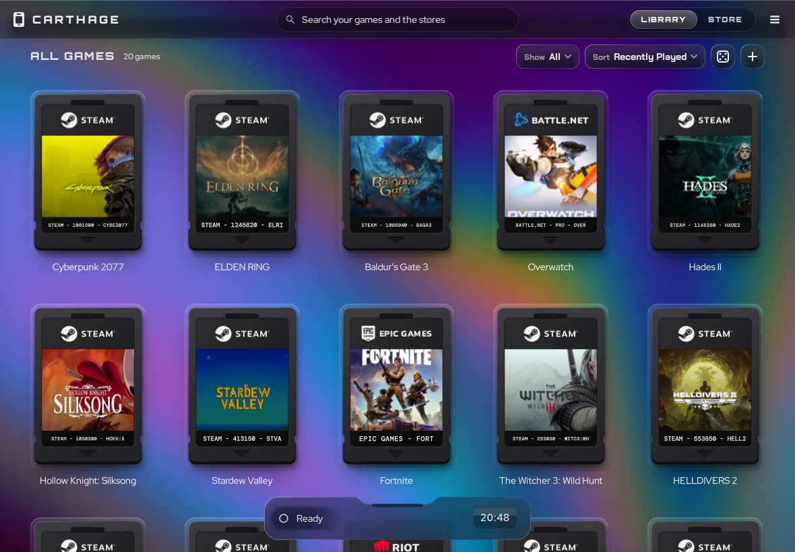
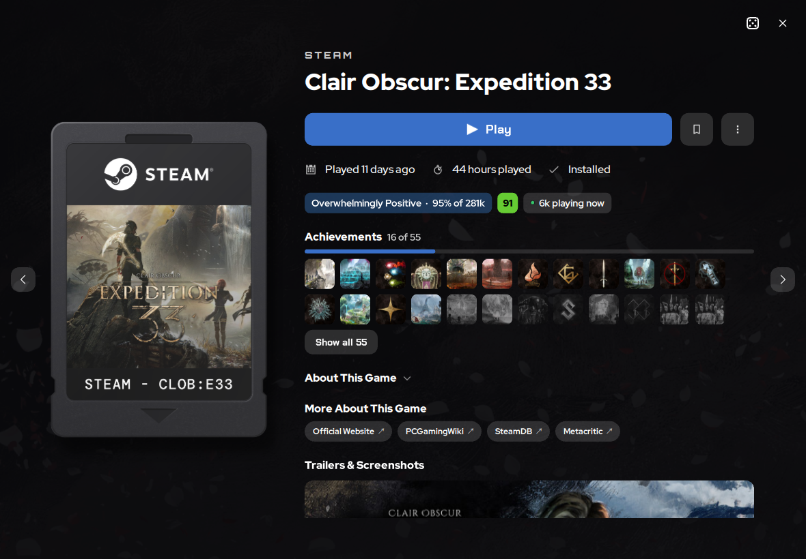
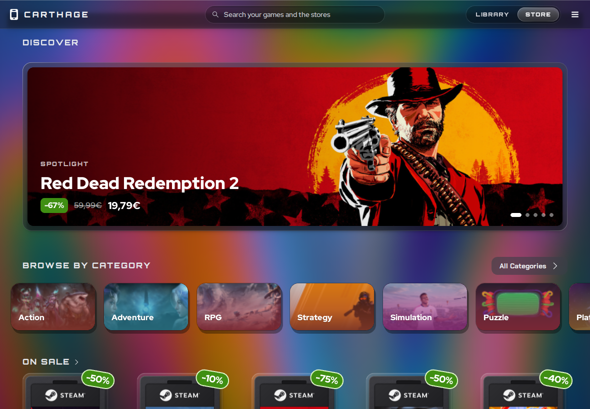

# Carthage







## Carthage
Carthage is a game launcher for Linux and Windows. It gathers your games from Steam, Heroic,
Lutris, Flatpak, Epic, Battle.net, Riot and games you add yourself, and shows them as cartidges. Launching a game makes it slide into the dock. You may also browse the Steam and Epic store from Carthage, allowing you to compare prices at a glance.


## Download

Get it from the [latest release](https://github.com/lopiksaa/carthage/releases/latest):

- **Windows:** the setup `.exe` (available, but not yet verified)
- **Linux:** run this in a terminal (running it again updates Carthage):

  ```sh
  curl -fsSL https://raw.githubusercontent.com/lopiksaa/carthage/main/install.sh | sh
  ```

  Or download the AppImage from the release.

Installed Windows and AppImage builds can download and apply updates. Other installs can check for
updates and open the release page. Control update checks in Settings → System.

## Keys and network

Carthage functions without any API keys: it reads installed and previously played Steam games from local files,
draws a printed label when art is missing, and shows the stores.
For optimal experience, two optional keys add full library (games not yet installed from Steam) and ability to customize art through SteamGridDB. You can add them during setup or later in Settings → Accounts & Keys:

| Key | What it adds | Service |
|---|---|---|
| SteamGridDB | Custom game art for your cartridges, fetched from SteamGridDB's website | www.steamgriddb.com |
| Steam Web API | Steam-owned games not found in local files, with Steam-reported playtime (game details must be public) | api.steampowered.com |

Keys are saved in your operating system's password store: Secret Service on Linux and Credential
Manager on Windows. They are not kept in Carthage's config or logs.

## Run from source

Carthage is Python 3.13+ and Qt Quick (PySide6 6.11).

**Arch / CachyOS** (the only distro Carthage has been tested on so far):

```sh
sudo pacman -S pyside6 qt6-declarative qt6-multimedia qt6-svg python-numpy python-pillow \
    python-xlib libsecret
python -m carthage
```

**Anywhere else:**

```sh
pip install "PySide6==6.11.*" numpy pillow
pip install python-xlib   # Linux: window handling
pip install psutil        # Windows
python -m carthage
```

flags:

- `python -m carthage --dev` reloads the interface when a QML file changes.
- Set `QT_FORCE_STDERR_LOGGING=1` to see QML errors.
- Set `GC_FAKE_COUNT=500` to fill the tray with 500 fake games.

`packaging/` builds the Windows installer and the Linux AppImage. The same steps run in
`.github/workflows/release.yml`.

## Credits

This project is inspired by [Cartridges](https://github.com/kra-mo/cartridges).

## License

Carthage is free software under the [GNU General Public License v3.0 or later](LICENSE).

The license covers the code, not the name or the logo. You're welcome to make your own version
of Carthage, but please give it a different name and icon, so nobody mistakes it for this one.

Fonts, icons, textures, sounds and launcher logos come from other projects and keep their own
licenses. See [THIRD_PARTY_NOTICES.md](THIRD_PARTY_NOTICES.md).

## Trademarks

Carthage is an independent project. It isn't affiliated with, endorsed or sponsored by any of
these companies or projects:

- Valve (Steam)
- Epic Games (Epic Games Store)
- Blizzard Entertainment (Battle.net)
- Riot Games
- CD PROJEKT (GOG)
- Electronic Arts (EA app)
- Microsoft (Microsoft Store, Xbox)
- Discord
- SteamGridDB and IsThereAnyDeal
- Heroic Games Launcher, Lutris and Flatpak

Their names and logos belong to their owners. Carthage shows a launcher's name or logo only to
tell you where a game comes from.

## AI Usage
Carthage was built using Claude Opus 5.5


Copyright © 2026 lopiksa
